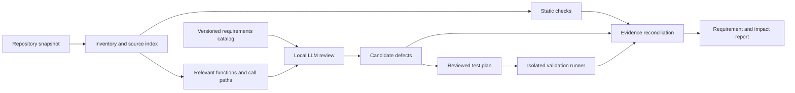

# PQScan: specification-based PQC review

Research and implementation proposal, 20 October 2026. This document proposes future capabilities; it does not claim they exist in the current scanner.

The proposed product answers three separate questions: does the implementation match the selected algorithm specification, does the application use that implementation securely, and can a suspected defect produce a reproducible security impact? An LLM helps connect specifications to code; executable checks and reviewed evidence establish the conclusions.

**What the project already does**

The current implementation in `pqscan.py` provides a useful starting point:

| Existing component | Current behavior | Required extension |
| --- | --- | --- |
| `scan_repository` / `analyze_source` | Traverses supported files; uses Python AST analysis and lexical rules | Index functions, callers, callees, configuration, and dependency versions |
| `correctness_compliance` | Recognizes parameter names and validation-related API tokens | Evaluate individual, versioned requirements against implementation evidence |
| `build_review_evidence` | Supplies at most 60 findings within a 12,000-character finding budget; excludes source bodies | Build bounded source slices with callers, error handling, and relevant requirements |
| `review_with_ollama` | Local structured commentary tied to existing finding IDs | Allow new, explicitly unverified hypotheses supported by source and requirement IDs |
| `fusion_assessment` | Combines adoption signals; correctly avoids certification claims | Reconcile static observations, model hypotheses, test results, and reviewer decisions |
| CLI, GUI, JSON and PDF | Present the existing inventory and evidence | Present requirement coverage, reproducible failures, impact, and unresolved questions |

The current scanner does not execute target code, validate cryptographic outputs, establish reachability, or demonstrate exploits. Its schema validation checks model output structure and references, not the truth of the reasoning. This inspection was of PQScan; no chatroom repository was selected or audited.

**The NIST specification baseline**

“NIST compliant” needs an explicit scope. Algorithm conformance, application security, algorithm validation, and cryptographic module validation are different claims.

| Source | What the implementation review should cover |
| --- | --- |
| [FIPS 203: ML-KEM](https://nvlpubs.nist.gov/nistpubs/FIPS/NIST.FIPS.203.pdf) | ML-KEM-512/768/1024; randomness (§3.3), encodings (§4), internal algorithms (§6), external input checks (§7), parameter sets (§8) |
| [FIPS 204: ML-DSA](https://nvlpubs.nist.gov/nistpubs/FIPS/NIST.FIPS.204.pdf) | ML-DSA-44/65/87; parameter and size tables (§4), external signing/verifying and prehash modes (§5), internal verification (§6.3), encodings and arithmetic (§7) |
| [FIPS 205: SLH-DSA](https://nvlpubs.nist.gov/nistpubs/FIPS/NIST.FIPS.205.pdf) | Twelve SHA2/SHAKE parameter sets (§11); internal signature processing (§9), external interfaces and context/prehash handling (§10) |
| [SP 800-227: KEM recommendations](https://nvlpubs.nist.gov/nistpubs/SpecialPublications/NIST.SP.800-227.pdf) | Implementation requirements (§3), secure application use (§4.2), shared-secret processing (§4.3), key confirmation (§4.4), and hybrid construction (§4.6) |
| [NIST ACVP documentation](https://pages.nist.gov/ACVP/) and [public vector corpus](https://github.com/usnistgov/ACVP-Server/tree/master/gen-val/json-files) | Reproducible algorithm tests with pinned vector revisions and explicit coverage |
| [CMVP / FIPS 140-3](https://csrc.nist.gov/projects/cryptographic-module-validation-program) | Separate module-validation status for the exact module, version, operating environment, and approved configuration |

NIST currently links potential-update errata from the [FIPS 203 publication page](https://csrc.nist.gov/pubs/fips/203/final) and [FIPS 204 publication page](https://csrc.nist.gov/pubs/fips/204/final). Those notices were checked; the individual spreadsheets were not adjudicated in this proposal. Before implementing a rule, review the applicable errata and record whether it changes the expected result. Do not silently treat proposed corrections as an already revised standard. Distinguish final publications from working documents such as the [ACVP ML-KEM protocol draft](https://pages.nist.gov/ACVP/draft-celi-acvp-ml-kem.html).

Store each requirement with an ID, source URL, publication/version, section or algorithm number, source hash, review date, obligation level, applicability conditions, expected behavior, verification method, and errata disposition. Keep normative requirements separate from recommendations and project-specific security policies. The initial catalog is deliberately partial and must expose its coverage.

**Initial requirements and defect families**

These are proposed review targets, not findings against a repository:

| Review target | Specification anchor | Concrete verification |
| --- | --- | --- |
| ML-KEM encapsulation input validation | FIPS 203 §7.2 | Incorrect key length and noncanonical encoded coefficients fail input checking |
| ML-KEM decapsulation input validation | FIPS 203 §7.3 | Check ciphertext/key lengths and the prescribed embedded-key hash consistency check |
| ML-KEM implicit rejection | FIPS 203 §6.3, Algorithm 18 | Correct-length ciphertext failing re-encryption comparison yields the specified fallback secret; distinguish this from external input-check errors |
| ML-KEM random generation | FIPS 203 §3.3 and §7 | Review generation of required randomness and propagation of generator failure |
| ML-DSA context and mode handling | FIPS 204 §5 | Exercise context lengths 0, 255, and 256; changed contexts; pure/prehash separation and the selected prehash identifier |
| ML-DSA invalid signature handling | FIPS 204 §6.3, Algorithm 8 | Mutated messages/signatures, decoding failures, norm bounds, and hint checks produce the specified failure outcome |
| SLH-DSA interface and verification | FIPS 205 §9.3 and §10 | Check selected-set signature length, context limits, pure/prehash separation, and tampered signatures |
| Peer ownership and handshake integrity | SP 800-227 §4.2 | Substitute peer keys or modify handshake messages in a controlled protocol test |
| Ephemeral key lifecycle | SP 800-227 §4.2 | Trace whether keys designated ephemeral are reused across key-establishment executions |
| Application enforcement | Provider API contract plus the chosen protocol specification | Verify that callers stop on failed verification, authentication, or input validation |

Several details prevent false alarms. ML-DSA explicitly permits deterministic signing; a zero `rnd` in that permitted mode is not inherently a bug. ML-DSA and SLH-DSA permit an empty context, and the required behavior for an overlong context is interface-specific. An ignored return value is meaningful only after establishing whether the actual provider returns a Boolean or raises on failure. Missing checks in an application wrapper may be implemented by its dependency. Optimized arithmetic should be compared for equivalent behavior, not textual similarity to pseudocode.

If a repository merely calls a provider, inspect its exact API contract and version, then test that provider/build where available. Do not claim to have audited inaccessible native code. Custom primitive implementations require a deeper arithmetic and side-channel workstream; generic repository traversal cannot prove constant-time execution or mathematical equivalence.

**Architecture for repository review and evidence fusion**

Use a stable source snapshot: repository commit when available, content hashes for included files and dirty changes, dependency/lockfile identities, and build information. A commit alone is insufficient for an uncommitted working tree. Attach this identity to every result.

The traversal should begin with the existing inventory, then expand through imports, wrappers, callers, error branches, and configuration. Also index entry points and crypto-related dataflow independently of existing token hits, so renamed wrappers and dynamic selection do not become invisible. Report unresolved dispatch, unsupported languages, missing dependencies, excluded files, and context-budget truncation as coverage gaps.

Start with Python semantic support because the project already has a Python AST path. Treat other languages as inventory-only until language-specific analysis is implemented. Distinguish conservative call-graph edges from demonstrated runtime reachability. For a Python application with native cryptography, the first milestone can review the Python integration and exercise a pinned provider without pretending to analyze its machine code.

The LLM receives a requirement, a bounded source slice, dependency contract, and available evidence. It returns a hypothesis, exact source locations, requirement IDs, observed behavior, expected behavior, missing context, possible impact, and a proposed falsification test. It can discover candidate issues beyond the scanner's initial findings. Validate that cited files, spans, hashes, and requirement IDs exist; semantic support still needs checking.

Keep the existing metadata-only review as the default. Source review is an explicit local mode with its own disclosure of what was read and sent. Treat repository text as untrusted data, enforce path and size limits, and prevent source comments from directing tools. The model has no arbitrary shell execution capability. A later runner executes reviewed adapters in an isolated environment with bounded resources and no default network access.

Fusion should use evidence rules rather than averaging confidence scores:

| Evidence | Permitted conclusion |
| --- | --- |
| Algorithm name/import | Capability or selection observed |
| Static checker or model identifies a suspicious path | Candidate defect with stated assumptions |
| Exact implementation fails a valid test with a trustworthy oracle | Reproduced conformance failure within that test scope |
| Application reproduction demonstrates attacker influence and security impact | Demonstrated exploitability under recorded conditions |
| Relevant tests pass | Those cases passed; remaining requirements retain their own statuses |
| Missing source or contradictory results | Unknown or disputed; expose the missing evidence |

An LLM repeating a regex finding is not independent corroboration. Deduplicate by requirement, source span, and root cause. Preserve contradictions and provenance. A failing local test must not erase a passing test for another requirement, nor should many passing tests cancel one reproducible defect.

Use separate fields for requirement status (`not_assessed`, `inconclusive`, `supported`, `violated`, `not_applicable`), evidence type, and exploitability (`not_assessed`, `hypothesized`, `demonstrated`, `not_reproduced`). `supported` always includes the scope and method; it is not a global compliance pass. Severity reflects impact and attacker conditions; confidence reflects evidence quality.

**Validation and exploitability**

Use known-answer tests, cross-implementation tests, malformed-input tests, and targeted mutations. Round trips alone are insufficient because two matching mistakes can interoperate. Pin public NIST vectors to a commit and checksum, retain expected-output provenance, and distinguish local vector execution from formal CAVP validation. When a public API cannot accept deterministic test inputs, record that limitation or use a dedicated test adapter; do not weaken the production randomness API to make testing convenient.

Keep public API tests separate from internal primitive tests. Run randomness-failure injection only where the test harness can do it meaningfully. Verify test setup and adapter behavior before treating a failure as a cryptographic defect. Record the runner, adapter, vector IDs, provider version, build flags, platform, command, and artifact hashes. A JSON assertion that tests passed is imported evidence, not automatically trusted execution evidence.

For the chatroom, first establish whether protection is client-to-server or end-to-end, how identities and public keys are bound, how group membership changes, and what forward-secrecy or post-compromise properties are claimed. Review transcript binding, negotiated algorithms, fallback, key derivation, authenticated encryption, nonce handling, replay, and rekeying against the actual protocol. These are application/protocol checks; do not label all of them FIPS 203 requirements.

Yes, the app can assess whether implementation defects are exploitable. Each candidate needs attacker access, attacker-controlled input, a reachable affected path, a security consequence, and a controlled reproduction. A useful local example is a wrapper that continues after a failed signature check: a negative test can establish whether a modified message reaches the authenticated-message handler. That is an integration defect even if the provider's signature mathematics is correct.

Conversely, a deviation in encoding does not by itself establish key recovery, and a timing difference does not by itself establish a practical remote attack. Side-channel assessment needs dedicated measurement and analysis tied to the compiled implementation and environment. Store minimized local reproductions and remediation tests. No exploitability conclusion is possible for the unspecified chatroom from this project inspection alone.

**Concrete implementation sequence**

The following paths and flags are proposed interfaces, not existing functionality. Preserve the portable, dependency-free inventory CLI; place advanced review in an optional package.

| Milestone | Deliverable and integration | Acceptance criteria |
| --- | --- | --- |
| 1. Requirements and report contract | `standards/` catalog and schema; `pqscan_analysis/requirements.py`; add a separate `specification_review` report section | Every included check has reviewed applicability and a section citation; unsupported requirements stay unknown; legacy JSON loads; no new certification claim |
| 2. Python source evidence | `pqscan_analysis/source_index.py` and provider adapters; optional `--review-source`; integrate alongside `build_review_evidence` | Follow aliased imports and multi-file wrappers; preserve exact locations/hashes; mark dynamic resolution and native-code boundaries; disclose omitted context |
| 3. Requirement-grounded LLM review | `pqscan_analysis/review.py`; structured hypotheses with source IDs and requirement IDs | Reject fabricated references; preserve metadata-only behavior; expose new hypotheses without promoting them to confirmed defects |
| 4. Reproducible validation | `pqscan_analysis/validation.py`; one pinned ML-KEM provider adapter, then an ML-DSA adapter; separate explicit validation command | Healthy implementations pass selected vectors; deliberately faulty fixtures fail expected cases; setup errors are distinct from conformance failures; target execution remains isolated |
| 5. Fusion and reports | `pqscan_analysis/evidence.py`; extend `load_report`, `render_text`, `render_pdf`, and the GUI compliance view | Show requirement status, evidence provenance, impact assumptions, reproduction, and coverage; model text or edited derived fields cannot grant verification |
| 6. Chatroom evaluation | One identified repository and protocol profile; controlled handshake/message tests | Trace key establishment through authenticated message handling; reproduce seeded integration defects; record attack preconditions and remediation regressions |

A strong first release completes milestones 1–4 for a deliberately narrow Python/provider scope. It should demonstrate a full chain from requirement to source to test result before adding more languages or claiming broad PQC coverage. The specific provider and chatroom should be selected at implementation kickoff based on the real target stack.

**Evaluation and later fine-tuning**

Start with a baseline model supplied with retrieved standards and source context. Fine-tuning becomes useful if measured errors show recurring weaknesses in locating relevant code, distinguishing provider behavior, applying requirements, or producing precise structured findings. Store changing standards in the retrieval catalog even after training.

Build a reviewed dataset of `(source slice, requirement revision, API contract, finding, evidence, reproduction, fix)` examples. Include correct implementations, permitted deterministic variants, checks performed in dependencies, exception-based APIs, unknown cases, and multi-file bugs. Mix carefully designed mutations with real reviewed defects; keep labels about conformance separate from labels about exploitability. Respect source licenses and remove secret material.

Split evaluation by repository lineage and implementation family, keeping vulnerable/fixed versions and related mutants together. Otherwise near-identical code can leak between training and evaluation. Have cryptographic reviewers adjudicate ambiguous cases; do not use the model's own unverified output as ground truth.

Compare four configurations on the same held-out cases: scanner only, scanner plus baseline LLM, scanner plus requirement retrieval and tests, and that full system with a fine-tuned model. Measure per-defect precision/recall, false positives on clean implementations, citation validity, requirement applicability, reproduction success, correct abstention, cost, and latency. Run ablations to determine whether gains come from training, retrieval, or executable verification.

Proposed initial release gates are 100% valid evidence references, no promotion from model prose to verified status, explicit coverage for every requirement in the selected profile, and successful detection of every designated seeded defect in the release fixture suite. Set precision/recall targets after measuring a representative benchmark, report sample sizes and uncertainty, and keep a separate untouched evaluation set for fine-tuning decisions.

Fine-tuning is a later optimization of the reviewer. It cannot replace test oracles, establish mathematical equivalence, or confer NIST validation. The immediate engineering priority is a trustworthy requirement-to-evidence pipeline.
